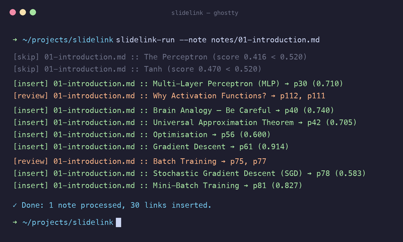

<div align="center">

# SlideLink

Match your Markdown lecture notes to PDF slides.

[](https://www.python.org/)
[](LICENSE)
[](https://github.com/yuazi/SlideLink/actions)



</div>

---

`SlideLink` matches sections in your Markdown notes to PDF slides and inserts links to PNG images. It uses TF-IDF text similarity and visual analysis. Everything runs offline, with no LLM or API keys; your notes and slides stay on your machine.

## How it looks

As `slidelink-run` processes each section, it prints one of these results:

- `[insert]`: A slide scored high enough to match. SlideLink renders it as a PNG and adds the link to your notes.
- `[review]`: Two slides have similar scores. SlideLink links both and adds a comment so you can choose.
- `[skip]`: No strong match was found. The section stays as it is.

### In your Markdown

Before:
```markdown
### Multi-Layer Perceptron (MLP)
The network output is f(X; W, b).
```

After:
```markdown
### Multi-Layer Perceptron (MLP)
<!-- slidelink:start -->


<!-- slidelink:end -->
The network output is f(X; W, b).
```

## Matching

TF-IDF (term frequency-inverse document frequency) compares the words in each note section with the slide text. Visual analysis checks images, diagrams, and drawing density to favor slides with useful visual content.

For "build" sequences, where successive slides add content, SlideLink favors the more complete slide. Optional LaTeX aliases help match math-heavy notes to slide text.

Headings, text, and image links inside fenced code blocks or YAML frontmatter do not affect matching. Both backtick and tilde fences are supported, including longer fences around Markdown examples.

## Why use this?

| Field | Example |
|---|---|
| Medicine | Link clinical notes to anatomical diagrams and X-rays |
| Psychology | Connect case study notes to experimental data visualizations |
| STEM | Pair LaTeX-heavy derivations with the matching algorithmic slide |
| Other subjects | Match your `.md` notes to `.pdf` slides |

## Getting started

The repo includes the folders used below.

### 1. Installation

Clone and install in editable mode:

```bash
git clone https://github.com/yuazi/SlideLink.git
cd SlideLink
pip install -e .
```

### 2. Add your files

- Put your `.md` notes in `notes/`.
- Put your `.pdf` slides in `notes/pdfs/`.

Use matching filenames for each note and PDF, such as `01_Intro.md` and `01_Intro.pdf`.

### 3. Run

```bash
slidelink-run
```

SlideLink exports matching slides to `notes/screenshots/` and inserts the image links into your notes.

Image links are relative to each note, including when you choose a custom folder with `--asset-dir`. Spaces and special characters in paths are escaped automatically. SlideLink skips PDFs with no searchable words; scanned slides need OCR before matching.

### 4. Undo

To remove SlideLink's inserted image links and review comments:

```bash
slidelink-revert --revert
```

Hidden `slidelink:start` / `slidelink:end` comments identify new insertions. Undo also recognizes older links in `screenshots/` with SlideLink's numbered `*_PgNNN_*.png` filenames.

Other images, Obsidian embeds, code fences, and frontmatter stay intact. Exported PNG files stay on disk. Use `--dry-run --revert` to preview which notes would change.

## CLI reference

| Argument | Default | Description |
|---|---|---|
| `--note` | None | Process a single markdown file instead of the whole directory. |
| `--notes-dir` | `notes` | Directory with markdown notes. |
| `--pdf-dir` | `notes/pdfs` | Directory with PDF slides. |
| `--asset-dir` | `notes/screenshots` | Where extracted slide images go. |
| `--min-score` | `0.33` | Minimum similarity score to accept a match. |
| `--subject-label` | `Lecture` | Prefix for image filenames and log output. |
| `--aliases-file` | None | JSON file mapping LaTeX commands to plain-text aliases. |
| `--headings-config` | None | JSON file with `skip` and `generic` heading lists. |
| `--dry-run` | `False` | Preview changes without touching any files. |
| `--revert` | `False` | Remove SlideLink's image links and review comments from notes. |

## Customization

### LaTeX aliases

Map LaTeX commands to words that may appear in the slides:

```json
{
  "\\nabla": ["nabla", "gradient", "grad"],
  "\\sigma": ["sigma", "sigmoid", "standard deviation"]
}
```

```bash
slidelink-run --aliases-file examples/aliases_stem.json
```

### Heading config

Choose headings to skip or require a higher match score:

```json
{
  "skip": ["introduction", "further reading"],
  "generic": ["overview", "results"]
}
```

```bash
slidelink-run --headings-config examples/headings_config.json
```

## Project structure

```
SlideLink/
├── notes/              # Your markdown notes go here
│   ├── pdfs/           # Your PDF slides go here
│   └── screenshots/    # Auto-generated slide images (created by the tool)
├── slidelink/          # Core Python package
├── examples/           # Example alias and heading config files
├── scripts/            # Helper scripts
└── tests/              # Test suite
```

## Contributing

[Open an issue](https://github.com/yuazi/SlideLink/issues) to report a bug or suggest a change.

## License

[MIT](LICENSE)
